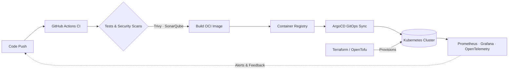

<div align="center">


### DevOps Engineer · Cloud & Platform Engineering · Automation First

<p><em>Automating workflows, optimizing infrastructure, and shipping scalable, secure cloud-native systems</em></p>

[](https://www.kdeelz.com)
[](mailto:rksuwendra@gmail.com)
[](https://github.com/kdeelz69)

<p>
  
  &nbsp;
  
  &nbsp;
  
  &nbsp;
  
</p>

[](https://git.io/typing-svg)

</div>

---

## About Me

```yaml
apiVersion: v1
kind: Engineer
metadata:
  name: Ravindu Kavishma
  username: kdeelz69
  location: Sri Lanka
  pronouns: he/him
spec:
  role: DevOps Engineer
  focus:
    - Automating workflows and cloud deployments
    - Optimizing scalable, cost-aware infrastructure
    - Building reliable CI/CD & GitOps pipelines
    - Shipping secure-by-default platforms (DevSecOps)
  philosophy: "If you do it twice, automate it."
status:
  openTo: [collaboration, open-source]
```

---

## How I Ship



---

## Tech Stack & Skills

<div align="center">

[](https://skillicons.dev)

[](https://skillicons.dev)

</div>

<table>
<tr>
<td valign="top" width="50%">

#### ☁️ Cloud & Infrastructure


#### 🐳 Containers & Orchestration


#### 🔁 CI/CD & GitOps


#### 🏗️ Infrastructure as Code


</td>
<td valign="top" width="50%">

#### 📈 Observability & Monitoring


#### 🔐 DevSecOps & Security


#### 🕸️ Networking & Service Mesh


#### 💻 Scripting & OS


</td>
</tr>
</table>

---

## Core Interests
- ☁️ **Cloud Infrastructure** — *AWS, Azure, GCP*
- 🔁 **CI/CD & GitOps** — *GitHub Actions, ArgoCD, Flux, Jenkins*
- 🐳 **Docker & Kubernetes** — *Helm, Kustomize, autoscaling with Karpenter*
- 🏗️ **Infrastructure as Code** — *Terraform, OpenTofu, Ansible*
- 📈 **Observability** — *OpenTelemetry, Grafana, Prometheus, Loki, ELK Stack*

---

## 🌱 Currently Learning

| Area | Tools & Topics |
| --- | --- |
| 🕸️ Advanced Kubernetes Networking | Cilium, eBPF, Gateway API, Istio Ambient Mesh |
| 🔐 DevSecOps & Supply Chain Security | Sigstore / Cosign, SBOMs, Kyverno policies, SLSA |
| 🧩 Platform Engineering | Backstage, Crossplane, Internal Developer Platforms |
| 🤖 AIOps & LLMOps | Running AI workloads on Kubernetes, AI agents for ops automation |
| 💰 FinOps | Cloud cost visibility with Kubecost / OpenCost |

---

## 🤝 Looking to Collaborate On
- Open-source DevOps Tools
- Automation Scripts for CI/CD Pipelines
- Kubernetes Patterns & Best Practices
- Platform Engineering & GitOps Templates

---

## 📊 GitHub Analytics

<div align="center">


&nbsp;


&nbsp;


</div>

<div align="center">

<picture>
  <source media="(prefers-color-scheme: dark)" srcset="https://raw.githubusercontent.com/kdeelz69/kdeelz69/output/profile-night-rainbow.svg"/>
  <source media="(prefers-color-scheme: light)" srcset="https://raw.githubusercontent.com/kdeelz69/kdeelz69/output/profile-green-animate.svg"/>
  
</picture>

</div>

<div align="center">

<picture>
  <source media="(prefers-color-scheme: dark)" srcset="https://raw.githubusercontent.com/kdeelz69/kdeelz69/output/github-snake-dark.svg"/>
  <source media="(prefers-color-scheme: light)" srcset="https://raw.githubusercontent.com/kdeelz69/kdeelz69/output/github-snake.svg"/>
  
</picture>

</div>

---

## Connect With Me

<p align="center">
  <a href="mailto:rksuwendra@gmail.com"></a>
  <a href="https://www.kdeelz.com"></a>
  <a href="https://github.com/kdeelz69"></a>
</p>

---

## Pronouns
**He/Him**

---

<details>
<summary><b>☕ Fun Fact</b> (click to expand)</summary>
<br/>

I can automate my coffee machine with a Raspberry Pi and Terraform - just kidding... or am I?

```bash
$ terraform apply -target=module.coffee_machine
Plan: 1 to add, 0 to change, 0 to destroy.
module.coffee_machine.espresso.this: Creation complete after 25s ☕
```

</details>

---

> _"Work smarter, not harder - automate all the things."_


<!--
kdeelz69/kdeelz69 is a special repository because its README.md appears on your GitHub profile.
-->
